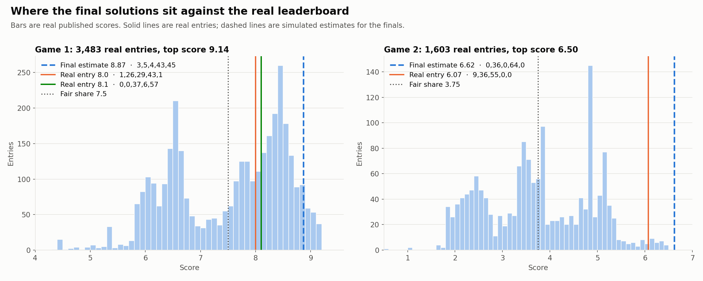
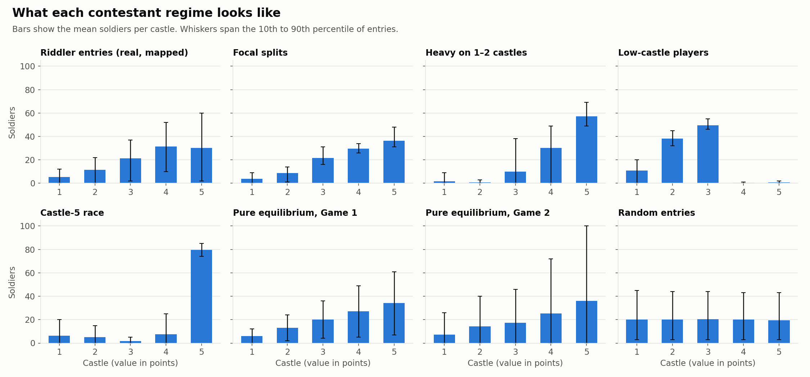
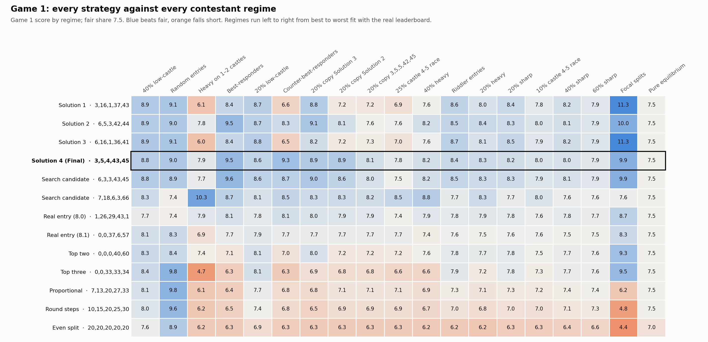
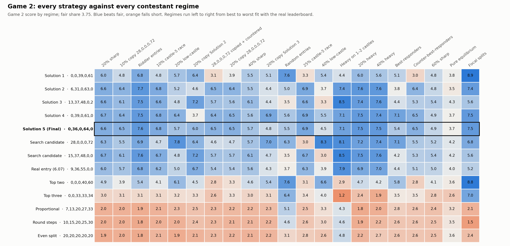
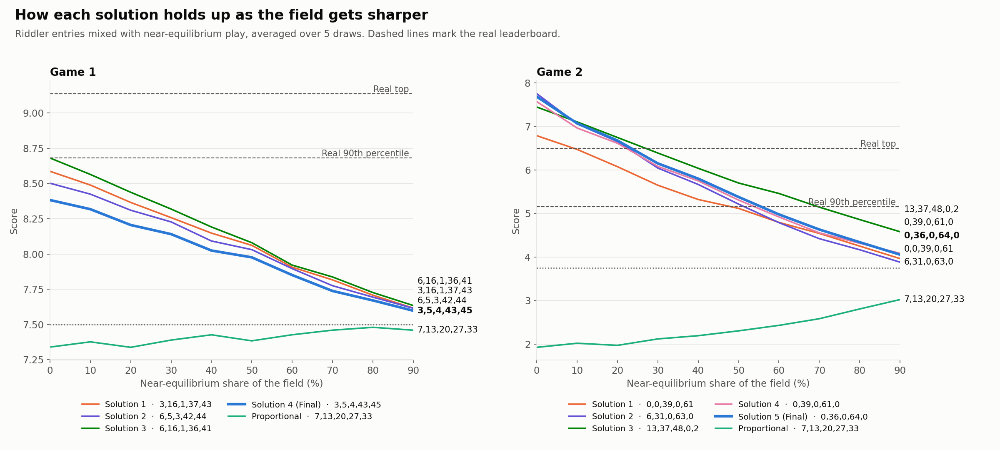
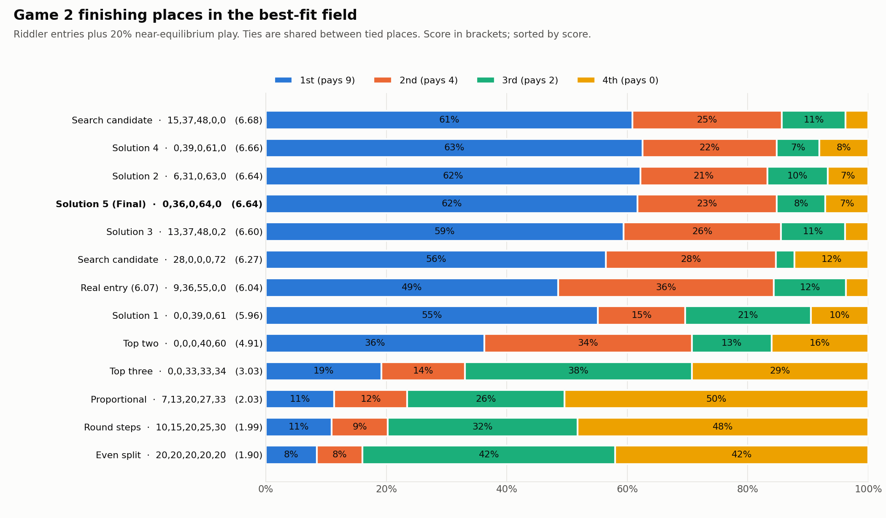
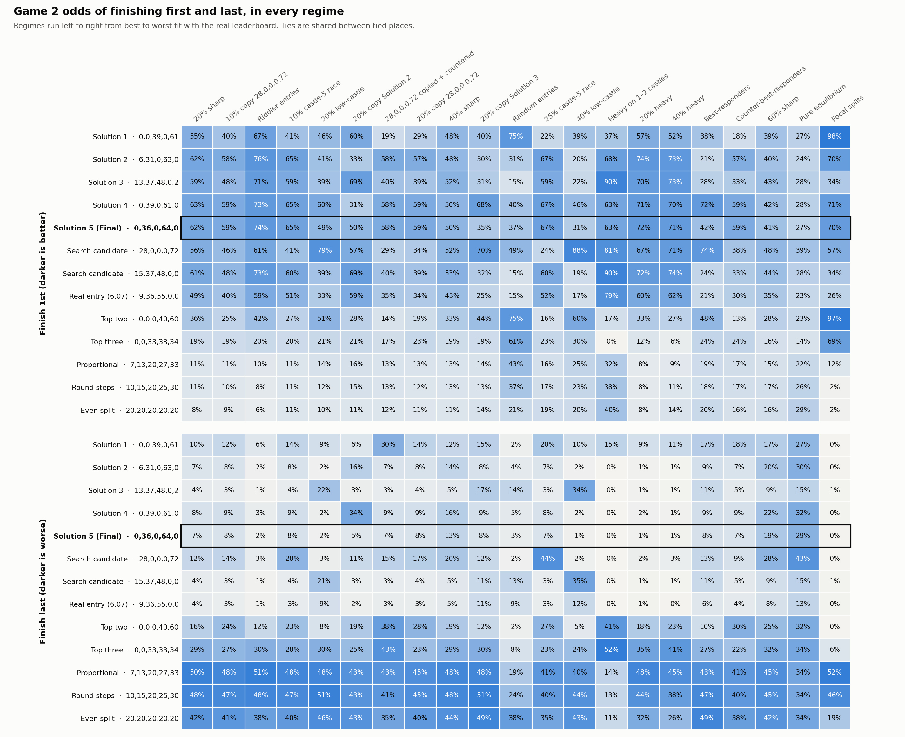
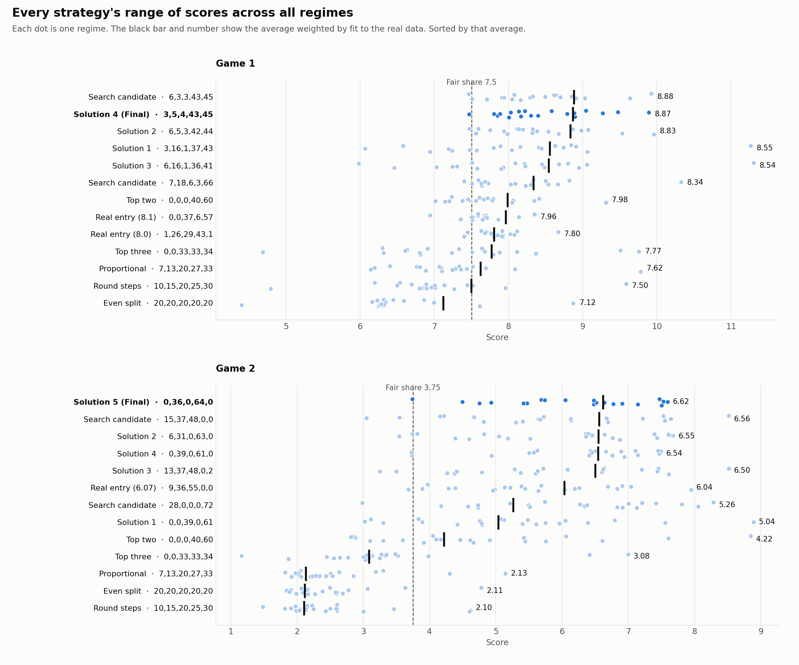
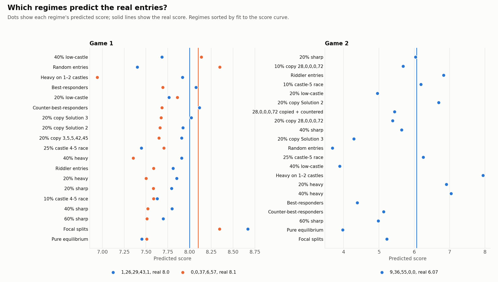
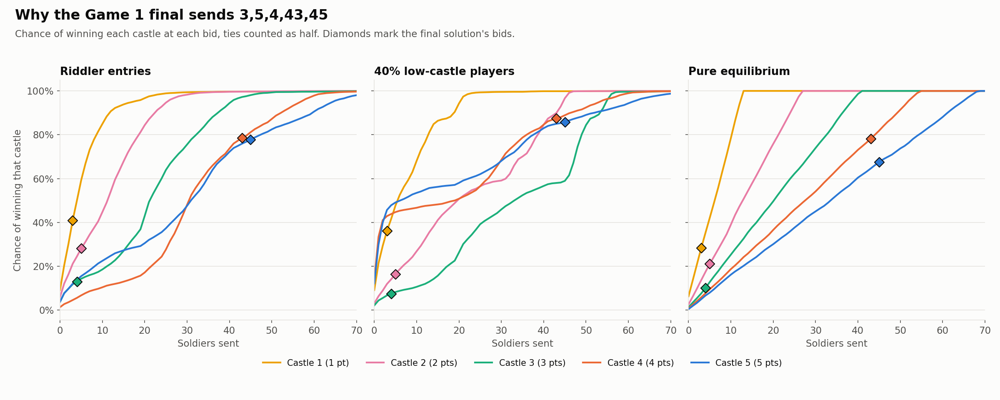

# No Limit Castle Challenge

A record of our attempt to top the Castle Challenge, the optional strategy game in the application for [No Limit: A Bot Building Tournament](https://pokerbot.sequoiacap.com/), hosted by Sequoia, OpenAI and Citadel Securities.

This README is written for people and agents picking the work up cold. It covers the problem, what we tried in order, what failed, the final answer and what the real result showed.

## Summary

| | Game 1: Head to Head | Game 2: Four-Way Battle |
|---|---|---|
| **Final allocation (castles 1–5)** | **3, 5, 4, 43, 45** | **0, 36, 0, 64, 0** |
| **Estimate before results** | 8.87 out of 15 | 6.62 out of 9 |
| **Real result** | **8.61**, about rank 449 of 3,487 (87th percentile) | **Not shown on the leaderboard** |
| **Top real score** | 9.137 | 6.497 |
| **Confidence in the estimate** | Low to moderate | Moderate |

We did not top the leaderboard. Game 1 finished well above average but far from first, and the estimate was 0.26 too high. Game 2 can't be judged, because the entry never appeared on the board (see [Actual result](#actual-result)).

**Main lesson:** we could search every possible allocation, so the search was never the limit. The limit was not knowing what other applicants entered. Real allocation-and-score pairs were worth far more than extra simulation.

## The problem

### The game

Each applicant splits **100 soldiers across 5 castles worth 1, 2, 3, 4 and 5 points**. Allocations must be whole numbers, 0 or more, adding up to exactly 100. Blank castles count as 0. That gives **4,598,126 possible allocations**. This is a form of Colonel Blotto.

**Game 1: Head to Head.** Your allocation plays every other applicant's. In each matchup, whoever sends more soldiers to a castle wins its points, and a tie splits them. Your score is your average across all matchups, out of 15. The field average is always 7.5.

**Game 2: Four-Way Battle.** You are placed in a random group of 4. Each castle goes to whoever sends the most, with tied castles split. Players are then ranked by castle points, and only your finish counts:

| Place | 1st | 2nd | 3rd | 4th |
|---|---|---|---|---|
| Payout | 9 | 4 | 2 | 0 |

Tied ranks split the payouts for those places. The published score averages 1,000,000 random groups, and the field average is 3.75.

### Constraints

- **It's one shot.** Entries go in with the application and are scored later, with no way to test scores first. The site doesn't say whether a second submission replaces the first.
- **There's no scoring in the browser.** The page only sends entries to a webhook.
- **Top scorers get priority registration.** Scores don't decide the bot tournament itself.
- **The public leaderboard shows scores, not allocations.** It publishes rank, score and identity, and says it updates every 15 minutes.

The Official Rules don't mention the Castle Challenge. Separately, rule 3.4 names only Astra and Codex as AI tools for the 60-minute bot build, so this work doesn't apply to that phase. Check the current rules before reusing any of it.

### Why "GTO" isn't the real target

Equilibrium only protects you against perfect opponents, but scores are measured against real applicants. In testing, a typical entry drawn from the near-exact Game 1 equilibrium landed around the 54th percentile. Topping a leaderboard needs the best response to the real field, so the hard part is working out what that field looks like.

### Structural facts

- **Game 1 adds up castle by castle.** A score depends only on how the field is spread across each castle, not on how each entry combines. That lets us calculate the exact best response to any field with a knapsack search.
- **Game 2 doesn't.** It depends on rank within a group, so it needs simulation.
- **Game 2 rewards winning.** First pays 9 and second pays 4, so being decent everywhere earns little.
- **Empty castles are almost certainly split.** Game 1's average is exactly 7.5, half of the 15 points, which only works if no points go unawarded.

## What we did

### 1. Solved the equilibria

| Game | Method | Result |
|---|---|---|
| Game 1 | Double oracle with exact best responses | Mixes 195 allocations; exploitable by only 0.0009 points; average near 6, 13, 20, 27, 34 |
| Game 2 | Fictitious play with hill-climbed best responses | Only approximate; the best counter still scored 4.03 against a fair 3.75 |

Neither gives a single entry to submit, because both are random mixes of many allocations.

### 2. Built a real field from public data

With no real entries available, we used [FiveThirtyEight's Battle for Riddler Nation data](https://github.com/fivethirtyeight/data/tree/master/riddler-castles): 4,510 entries from rounds 1–4, with 100 soldiers across 10 castles worth 1–10. Merging adjacent castles into pairs gives value shares of 5.5, 12.7, 20, 27.3 and 34.5%, close to this game's 6.7, 13.3, 20, 26.7 and 33.3%. Round 5 used 13 castles and was left out.

- **Mapping check:** merged scores correlated with real scores at only 0.20–0.54, so this keeps a field's shape but not its detail.
- **Backtest:** a best response to earlier rounds reached the 28th, 99.9th and 87th percentiles in the next round. The miss came right after players had seen published results.

### 3. Used the real leaderboard

The board was far sharper than our Riddler model expected. Our Game 1 pick at the time looked like a top 0.1% entry against Riddler data, then only around the 83rd percentile or lower against real scores.

We kept ranks and scores only, never names or schools. The exact tied scores also suggested groups of identical entries, including 98 Game 2 entries tied at exactly 4.847.

### 4. Tried to reconstruct the field (failed)

We tried to rebuild the real field from scores alone. All three attempts failed when tested on synthetic fields with known answers, and picks made from them did worse than the plain Riddler field:

| Script | Approach | Why it failed |
|---|---|---|
| `invert_g1.py` | Redraw allocations to earn each published score | Never settled on a field that reproduced its own scores |
| `transport.py` | Nudge a population of entries toward its scores | Same problem, and starting points didn't help |
| `calibrate.py` | Fit about 25 mixture weights to the score curve | Eight very different mixtures fit almost equally well |

**Scores alone don't reveal allocations.** Don't retry this without many real allocation-and-score pairs. Don't treat these scripts' output as evidence.

A simpler test with one unknown did work: mixing Riddler entries with 20% near-equilibrium play closely matched the Game 2 board.

### 5. Searched every allocation

We scored all 4,598,126 allocations against 16 contestant regimes, then re-tested finalists on fresh fields so the winner wasn't just lucky.

The first winner, 28,0,0,0,72, collapsed under direct attack, falling from 6.30 to 3.02 in a castle-5 race. That exposed a rock-paper-scissors cycle:

| Strategy | Beats | Is beaten by |
|---|---|---|
| 28,0,0,0,72 | Low-castle crowds | A castle-5 race |
| 13,37,48,0,2 | Heavy fields | Low-castle crowds |
| 6,31,0,63,0 | Castle-5 races | Being copied |

So we added those attacks as regimes and searched all 4.6 million allocations again across 21 regimes. **No strategy wins everywhere**, so the realistic goal was a strategy with no catastrophic regime.

### 6. Tested against real entries

We were given three real allocations with known scores. These were the most valuable data in the project:

| Game | Entry | Real score | Board position |
|---|---|---|---|
| Game 1 | 1, 26, 29, 43, 1 | 8.0 | About rank 1,500 |
| Game 1 | 0, 0, 37, 6, 57 | 8.1 | About rank 1,390 |
| Game 2 | 9, 36, 55, 0, 0 | 6.07 | Rank 27 of 1,603 (98th percentile) |

- **Game 2 passed.** The regime already chosen as the best fit predicted about 6.2 for this entry without seeing its score. Regimes full of low-castle players or best-responders predicted about 3.9 and were ruled out.
- **Game 1 failed.** Fitting one entry and predicting the other gave about 8.9 for an entry that really scored 8.0. No single regime matched both entries closely.

This moved Game 2 from 0,39,0,61,0 to 0,36,0,64,0, which held up best however much we trusted that single entry.

**A note on bad data:** the Game 1 and Game 2 entries were first supplied swapped, which briefly produced a striking but false conclusion that about 45% of the field left castles 4 and 5 empty. We withdrew it once corrected. Check entries against the board before drawing conclusions from them.

## How the solutions evolved

Solutions are numbered in the order we reached them.

| Solution | Game 1 | Game 2 | Why it changed |
|---|---|---|---|
| **1** | 3,16,1,37,43 | 0,0,39,0,61 | First picks, against an invented field |
| **2** | 6,5,3,42,44 | 6,31,0,63,0 | Rebuilt on Riddler data |
| **3** | 6,16,1,36,41 | 13,37,48,0,2 | Adjusted after the real leaderboard appeared |
| **4** | **3,5,4,43,45 (Final)** | 0,39,0,61,0 | Best after the exhaustive search |
| **5** | | **0,36,0,64,0 (Final)** | Best after testing the real Game 2 entry |

## Plotted results

Plot 1 uses real data, and plots 5 and 9 include real reference lines. Everything else is simulated, because no real allocations are public beyond the three entries above. Each game shows 13 strategies across 19 regimes in Game 1 and 21 in Game 2.

### Real leaderboard

Game 1 has two clear camps. Game 2 has a spike of identical scores at 4.847. Dashed lines are our estimates made before results.



### Contestant regimes

Most regimes have similar averages, and spread is what separates them. Low-castle players and castle-5 racers are the clear exceptions.



### Game 1 strategy table

Regimes run from best to worst fit with the real scores. Solution 4 never falls more than about 0.03 below fair, while Solutions 1 and 3 drop to about 6 against heavy fields.



### Game 2 strategy table

Spreading out is punished far harder here: proportional and even splits score about half of fair in most regimes. Every leading strategy has a regime that hurts it.



### Score vs sharpness

Edges shrink as the field gets sharper. This view favours the earlier solutions in both games. The finals won on breadth across regimes, not here.



### Game 2 finishing places

These are exact odds in the best-fit field. The top five are within 0.08 of each other, and Solution 5 is tied for third at 6.64.



### Game 2 odds in every regime

Shows how a strategy earns its score: Solution 3 usually avoids last place until low-castle crowds push that to 34%, and Solution 4 finishes last about a third of the time when Solution 2 is widely copied.



### Score range by strategy

Each dot is one regime, and the bar is the average weighted by fit to the real data. Solution 5 has the best weighted average in Game 2 at 6.62.



### Regimes vs real entries

Game 2's best-fit regime predicts its real entry closely. No Game 1 regime predicts both entries well, which is why Game 1 confidence stayed lower.



### Game 1 win curves

Shows why the final bids sit where they do: at 43 and 45 soldiers, castles 4 and 5 are won often in every field shown.



## Actual result

**Game 1: 8.61.** That was about rank 449 of 3,487, or the 87th percentile. The estimate of 8.87 was 0.26 too high. The 20% low-castle regime predicted the score best at 8.58, which suggests the real field held a sizeable low-castle group. Several hundred entries still beat this pick, so the field had a weakness our models missed.

**Game 2: no score available.** The entry isn't on the board, so 0,36,0,64,0 remains untested. The board also looks stalled: across three snapshots over about 2 hours 15 minutes, all 1,603 Game 2 scores stayed identical, while Game 1 grew from 3,478 to 3,487 and over 1,000 of its score values shifted. The page code has no Game 2 filter, and the board lists scores as low as 0.55, so a performance cutoff looks unlikely.

The cause isn't known from the outside. A stalled update is our best guess, and an unrecorded entry is also possible. We emailed the organisers to ask, and **no reply had been received when this was written.**

## Limitations

- **The real field stayed unknown.** Three real entries are very little evidence, and every regime is partly our own assumption.
- **Fit weights are a judgement call.** Different weightings reorder close strategies.
- **The Game 2 equilibrium never fully converged.** Regimes built on it inherit that.
- **Riddler readers aren't this applicant pool.** They played a harder 10-castle game, and four-way play has no real public data.
- **AI answers weren't sampled.** Many applicants likely asked chatbots, which could cause clustering that we couldn't measure.
- **Solutions 1–3 were briefly public.** The repo was public before the final picks were added, then made private before they were pushed. Earlier picks could have been copied, though that's unlikely to have mattered much.

## If you try this again

1. **Collect real allocation-and-score pairs first.** Even a small varied set beats more simulation, especially entries near the top. We guessed that 20–50 might pin down Game 1, but never tested that number.
2. **Test on data you haven't fitted.** Synthetic checks and hold-out predictions caught every false lead here.
3. **Attack your own winner.** Build regimes specifically to beat it, then search again.
4. **Treat clean results with suspicion.** Scores that look too good usually mean the field is missing something.
5. **Keep picks private until you've submitted.** Crowding is one of the biggest risks in this game.
6. **Look at what scored 9.0+ in Game 1.** Those entries were the largest unexplained gap, and even one known allocation would teach a lot.

## Repository guide

```text
castle/      Scorers, solvers, searches and plots
castle/plots Final figures
data/raw     FiveThirtyEight Riddler entries
data/*.json  Leaderboard snapshots: ranks and scores only
```

| Files | Purpose |
|---|---|
| `scoring.py`, `game2.c` | Exact scorer in Python, and the fast Game 2 simulator |
| `test_scoring.py`, `test_game2_c.py` | Hand-checked tests and a cross-check of the two scorers |
| `game1_solve.py` | Game 1 equilibrium |
| `riddler.py`, `field.py` | Real Riddler entries and assumed field archetypes |
| `game1_robust.py`, `game2_robust.py`, `robust2.py` | Early robustness tests and held-out rounds |
| `stress.py`, `stress2.py`, `tune.py`, `sharpness.py` | Stress tests, fine-tuning and field sharpness |
| `search.py`, `attack.py`, `round2.py` | Exhaustive search, attacks and the second search round |
| `anchor.py`, `anchor_g2.py`, `fit_field.py` | Tests against real entries |
| `invert_g1.py`, `transport.py`, `calibrate.py` | **Failed** reconstructions, kept as a record |
| `final_data.py`, `plots.py` | The numbers behind the final figures, and the figures |

## Reproduce it

You'll need Python with `numpy`, `scipy`, `numba`, `matplotlib` and `pytest`, plus a C compiler. Run everything from `castle/`. Generated files go in `results/`, which isn't in Git.

```bash
cd castle
mkdir -p results
cc -O3 -mcpu=native -o game2 game2.c -lpthread
python3 -m pytest -q test_scoring.py test_game2_c.py
cc -O3 -mcpu=native -o game2 game2.c -lpthread
```

The test run rebuilds `game2` at a lower optimisation level, so compile it again afterwards.

Build the equilibria and the Riddler field:

```bash
python3 game1_solve.py
./game2 fp 400 3000 24 results/game2_archive.txt 1
python3 riddler.py
```

Run both search rounds. Each `screen` step takes minutes and writes hundreds of MB:

```bash
python3 search.py prep
./game2 screen 2000 results/search/all results/search/regime{0..15}.txt
python3 search.py refine
python3 round2.py prep
./game2 screen 2000 results/search/round2 results/search/extra{0..4}.txt
python3 round2.py refine
python3 round2.py game1
```

Test against the real entries, then rebuild the figures:

```bash
python3 anchor.py
python3 anchor_g2.py
python3 final_data.py
python3 plots.py
```

## Data and privacy

The leaderboard file also contains applicant names and schools. We stripped those on download, so the snapshots here hold only ranks and scores. Riddler data comes from [FiveThirtyEight](https://github.com/fivethirtyeight/data/tree/master/riddler-castles). We didn't submit test entries, decode leaderboard IDs or use the site's webhooks.

## License

The code and documentation are available under the [MIT License](LICENSE). This doesn't cover `data/`: the Riddler entries stay under FiveThirtyEight's terms, and the leaderboard scores come from the competition site.
